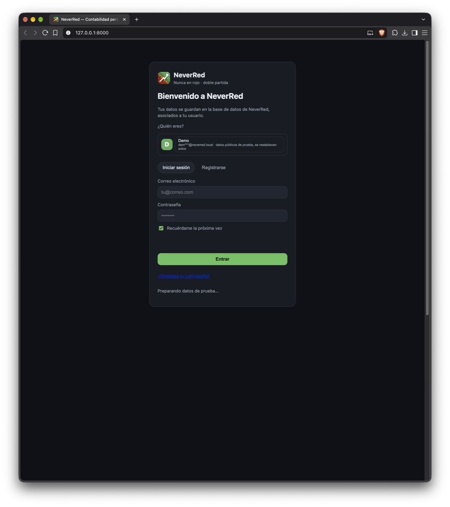
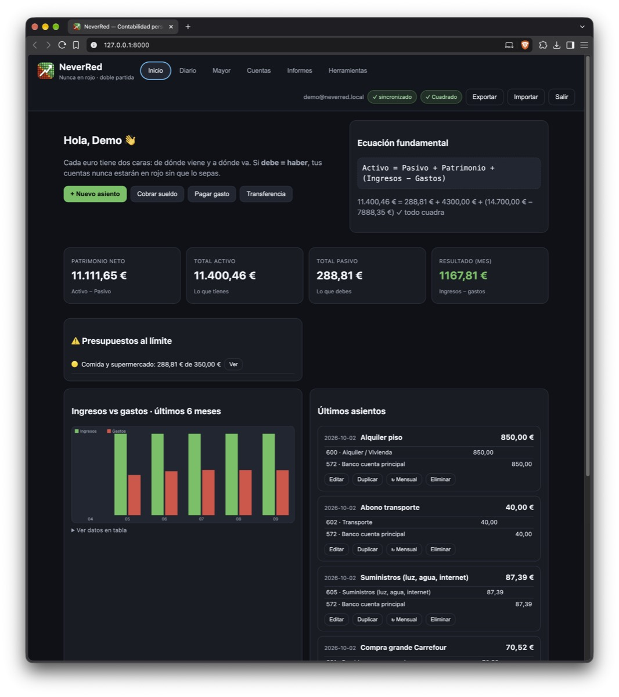
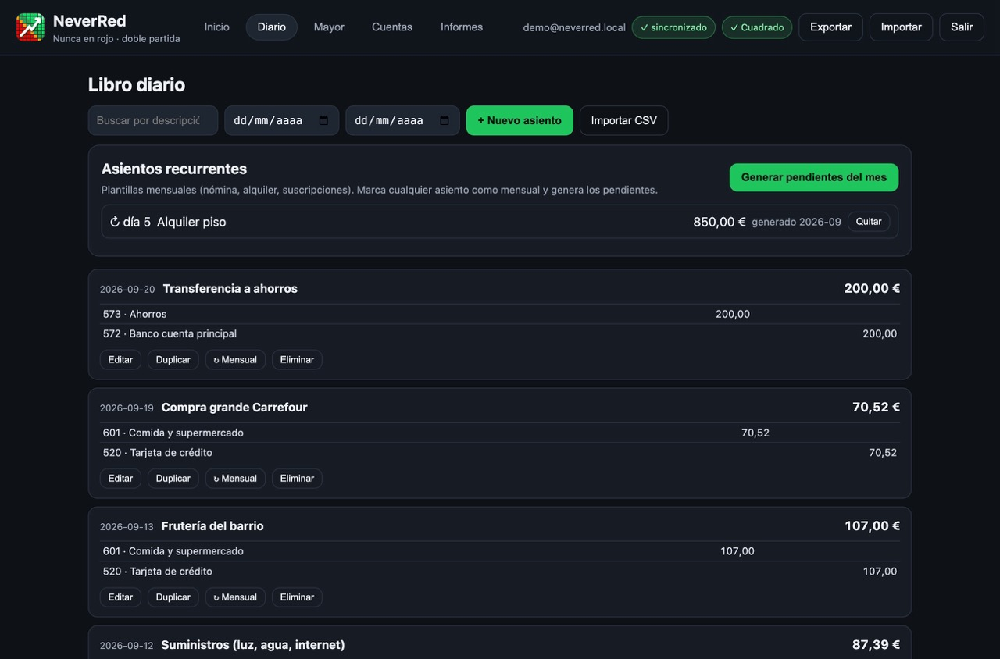
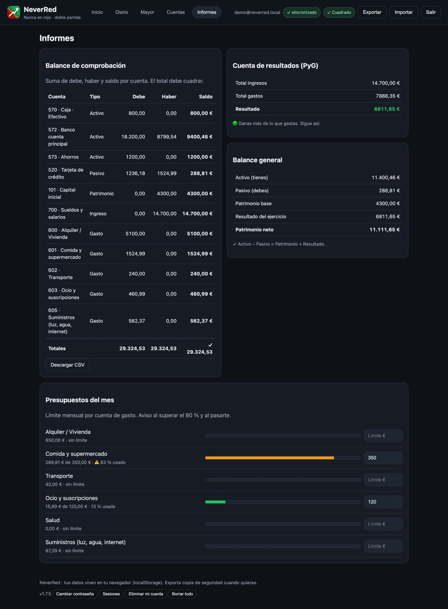
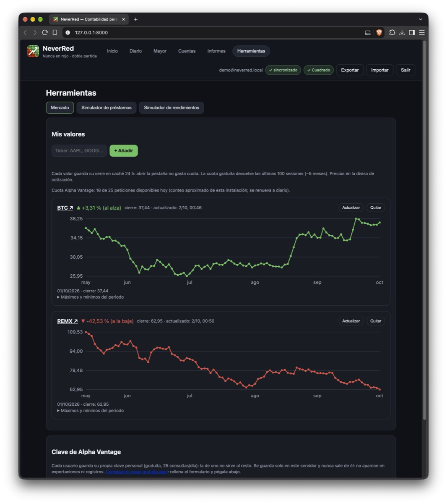

# NeverRed 🟢

Contabilidad personal con el sistema de **doble partida**. Simple para empezar, rigurosa para mantener.

> Cada euro tiene dos caras: de dónde viene y a dónde va. Si **debe = haber**, nunca estarás en rojo sin saberlo.

## Empezar en 1 minuto

**En Mac, sin instalar nada:** descarga el `.dmg` ([Releases](https://github.com/emilio-devesa/NeverRed/releases), vale para Intel y Apple Silicon), arrástralo a Aplicaciones y haz doble clic. Si macOS lo bloquea la primera vez, sigue la [guía de apertura](guia#instalar-en-macos-primera-vez). La app avisa sola cuando hay actualización. Al salir de la app o cerrar su última pestaña, todo se detiene solo.

**En Windows, sin instalar nada:** descarga el instalador `NeverRed-setup-*.exe` de Releases y haz doble clic: asistente en español, sin permisos de administrador y sin instalar Python. Si Windows muestra el aviso de SmartScreen la primera vez, pulsa **Más información → Ejecutar de todas formas** (más detalles en la [guía](guia#instalar-en-windows-primera-vez)). Tus datos quedan en `%APPDATA%\NeverRed` y se conservan aunque desinstales; las actualizaciones llegan solas. También hay un ZIP portable (requiere Python 3.12 en el equipo).

**En Linux, sin instalar nada:** descarga el `.AppImage` de Releases, dale permiso de ejecución y haz doble clic. Tus datos quedan en `~/.local/share/NeverRed`; `./NeverRed-*.AppImage --stop` lo detiene del todo.

**Desde código:**

```bash
python3 backend/server.py
```

Abre **http://127.0.0.1:8000**, regístrate con tu correo y crea tu asiento de apertura. O pruébala con datos de ejemplo:

```bash
python3 backend/seed_demo.py   # demo@neverred.local / DemoNeverRed2026
```

## Qué verás







Sigue en la [guía de uso](guia).

## Novedades en v2.6.8

Mejoras internas: el backend queda separado en módulos (`config`, `schema`, `auth`, `static`, `market` y `telemetry`), con más pruebas (115 en verde), métricas de latencia opt-in y un dashboard de telemetría más robusto. No cambia nada en el uso diario. Y en lo visible para ese sistema: **NeverRed debuta en Windows** con instalador nativo y actualizaciones integradas.

## Novedades en v2.6.7

La app carga y responde más rápido: HTTP/1.1 real (conexiones reutilizadas), estáticos comprimidos con gzip y ETag (recargas sin re-descargar) y CSP estricta que bloquea estilos inyectados. Además, los actualizadores de macOS y Linux se reescriben y unifican.

## Novedades en v2.6.6

Sesiones mejoradas (30 días con inactividad garantizada a los 7) y rendimiento: solo se repinta la pestaña que estás viendo. Fechas en formato local y validación contable más rigurosa en el servidor.

## Novedades en v2.6.5

Más privacidad y protección: CORS y cabeceras endurecidas, la API nunca se cachea (`no-store`), recursos estáticos solo desde lista blanca y el modo sin conexión más cuidadoso — si la carga inicial falla no se machacan los datos del servidor: elegirás «Recargar del servidor» o «Trabajar sin conexión».

## Novedades en v2.6.4

Tickers de Mercado reordenables: arrastra las tarjetas (o usa ↑/↓) y tu orden se conserva entre sesiones.

## Novedades en v2.6.3

Mercado adaptado al plan gratuito actual de Alpha Vantage (serie diaria, 1 petición por ticker) y mensajes de error que distinguen entre fallo de conexión, ritmo excesivo y cuota diaria agotada.

## Novedades en v2.6.1

Mercado con **precios ajustados** (adiós a los saltos falsos por splits) y **dividendos/splits marcados** en gráfica y desplegable; **Diario paginado** (50 por tanda); **aviso de copia** si llevas 30 días sin exportar; las **archivadas siguen contando** en todos los informes.

## Novedades en v2.6.0

Nueva pestaña **Herramientas**: **Mercado** (gráficas de tickers como AAPL o AIR.MC, con tu clave gratuita de Alpha Vantage —cada usuario la suya— y cuota diaria visible), **simulador de préstamos** (cuota francesa con gráfica anual) y **simulador de rendimientos** (interés compuesto con aportaciones). Además, **Informes reordenados**: Balance y PyG lado a lado arriba, evoluciones y comprobación plegables.

## Novedades en v2.0.0

**Telemetría opcional**: la app puede registrar qué funciones usas (solo conteos, nunca importes ni textos) para ayudar a mejorarla. Apagada por defecto —se pregunta una sola vez al entrar— y puedes activarla o desactivarla cuando quieras desde el pie de la app, en **Telemetría**.
